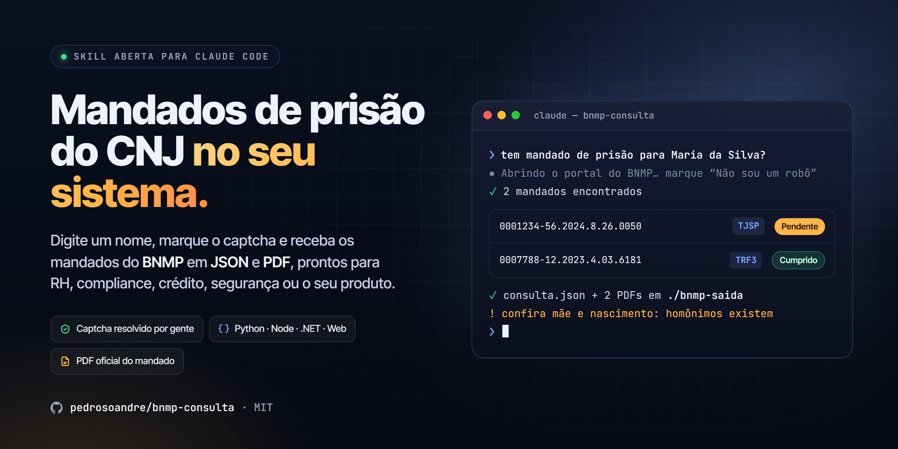
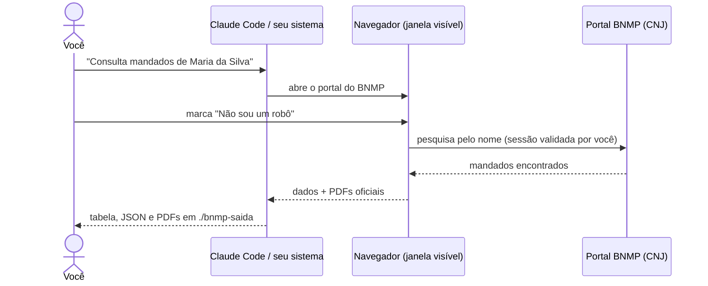

<p align="center">
  
</p>

<p align="center">
  <a href="#instalar-em-1-minuto"></a>
  
  
  <a href="LICENSE"></a>
</p>

<h3 align="center">Consulte o Banco Nacional de Mandados de Prisão do CNJ em menos de um minuto<br>e coloque essa consulta dentro de qualquer sistema.</h3>

---

O **BNMP** (Banco Nacional de Medidas Penais e Prisões, do CNJ) é a fonte oficial dos mandados de prisão expedidos por todos os tribunais do Brasil. É público, mas foi feito para consulta manual: uma tela, um captcha, uma pessoa de cada vez, sem formato que outro sistema consiga ler.

O **bnmp-consulta** encurta esse caminho:

1. Você digita um nome.
2. Marca o "Não sou um robô".
3. Recebe os mandados organizados em **JSON**, com o **PDF oficial** de cada um, prontos para entrar na sua planilha, no seu CRM, no seu fluxo de compliance ou no seu produto.

Funciona de dois jeitos:

- **Conversando com o Claude Code:** "tem mandado de prisão para Fulano?"
- **Como peça do seu software:** Python, Node, .NET, Java, PHP ou qualquer linguagem que execute um programa e leia JSON.

## Para quem é

| Setor | Onde a consulta entra |
|---|---|
| **Compliance, PLD e KYC** | Due diligence de sócios, administradores, fornecedores e clientes de alto risco, com fonte oficial e PDF para o dossiê |
| **Bancos, fintechs e crédito** | Etapa extra na análise de cadastros de risco elevado, com evidência anexada ao processo |
| **Fusões, aquisições e investimentos** | Checagem dos sócios e gestores da empresa-alvo antes de assinar |
| **Segurança privada e facilities** | Credenciamento de vigilantes e prestadores com acesso a áreas sensíveis |
| **Plataformas e marketplaces** | Verificação de parceiros que entram na casa das pessoas: mobilidade, entregas, serviços domésticos, saúde em domicílio |
| **Escolas, clínicas, ONGs e cuidadores** | Quem vai trabalhar com crianças, idosos e pessoas vulneráveis |
| **RH e recrutamento** | Cargos em que a lei ou a natureza da função justificam a checagem (veja [Uso responsável](#uso-responsável)) |
| **Advocacia, defensoria e assessoria jurídica** | Situação atualizada de clientes e partes, com o mandado em PDF para o processo |
| **Jornalismo e checagem de fatos** | Confirmar, na fonte oficial, a situação de figuras públicas |
| **Desenvolvedores e govtechs** | Uma consulta pronta e testada para embutir no produto, sem reescrever do zero |

## Como funciona



**Você resolve o captcha, a skill faz o resto:** preenche o nome, pesquisa, lê as páginas de resultado (até 10 páginas, ou 100 mandados, ajustável), baixa os PDFs, identifica o tribunal pelo número do processo (STF, STJ, TRF, TJ…) e entrega tudo organizado.

## Instalar em 1 minuto

No Claude Code:

```
/plugin marketplace add pedrosoandre/bnmp-consulta
/plugin install bnmp-consulta@bnmp-consulta
```

E uma vez no computador:

```
pip install playwright
```

A skill usa o Edge ou o Chrome que você já tem. Se não tiver nenhum dos dois, rode também `python -m playwright install chromium`.

## Usar

Peça do jeito que você falaria:

> **"Consulta se a Maria da Silva tem mandado de prisão e baixa os PDFs."**
>
> **"Verifica no BNMP os três sócios deste contrato social."**
>
> **"Coloca no meu sistema um botão de consulta de mandados na ficha do cliente."**
>
> **"Meu app em React precisa de uma tela de consulta de mandados."**

O Claude escolhe sozinho o caminho certo para cada caso: consultar agora, integrar no seu backend ou criar a tela no seu app.

## Integrar em qualquer sistema

O coração da skill é um único arquivo, [`consulta_bnmp.py`](skills/consulta-mandados-bnmp/scripts/consulta_bnmp.py), que depende só do Playwright. Copie para o seu projeto e chame:

```bash
python consulta_bnmp.py "Maria da Silva" --pdf --saida bnmp-saida
```

**Python**

```python
import json, subprocess, sys

def consultar_bnmp(nome: str) -> dict:
    p = subprocess.run([sys.executable, "consulta_bnmp.py", nome, "--pdf"],
                       capture_output=True, text=True, encoding="utf-8", timeout=600)
    if p.returncode != 0:
        raise RuntimeError(p.stderr.strip())
    return json.loads(p.stdout)
```

**Node.js**

```js
import { execFile } from "node:child_process";

export const consultarBnmp = (nome) => new Promise((ok, falha) =>
  execFile("python", ["consulta_bnmp.py", nome, "--pdf"], { encoding: "utf8", timeout: 600_000 },
    (erro, stdout, stderr) => (erro ? falha(new Error(stderr.trim())) : ok(JSON.parse(stdout)))));
```

**App web ou mobile para o público?** O servidor não consegue resolver o captcha por ninguém. Nesse caso, o app copia o nome e abre o portal para a pessoa. O exemplo pronto, com as armadilhas já resolvidas (`window.open` com `noopener` devolvendo `null`, área de transferência que falha em WebView, pop-up bloqueado), está em [`integracao-app.md`](skills/consulta-mandados-bnmp/integracao-app.md).

## O que você recebe

```json
{
  "busca": "Maria da Silva",
  "consultado_em": "2026-11-26T10:20:24",
  "fonte": "https://portalbnmp.cnj.jus.br/#/pesquisa-peca",
  "total_no_portal": 1,
  "mandados": [{
    "numero": "0001234-56.2024.8.26.0050.01.0001-01",
    "nome": "MARIA DA SILVA",
    "situacao": "Pendente de Cumprimento",
    "peca": "Mandado de Prisão",
    "orgao": "1ª Vara Criminal de São Paulo",
    "tribunal": "TJSP",
    "uf": "SP",
    "data_expedicao": "05/03/2024",
    "processo": "00012345620248260050",
    "nome_mae": "ANA DA SILVA",
    "data_nascimento": "02/01/1990",
    "pdf": "bnmp-saida/pdf/0001234-56.2024.8.26.0050.01.0001-01.pdf"
  }]
}
```

*(Dados fictícios; principais campos. O JSON também traz alcunha e identificadores internos do portal.)* Cada consulta também fica gravada em `bnmp-saida/consulta_<nome>_<data>.json`, o que serve de trilha de auditoria.

Códigos de saída para o seu sistema tratar:

| Código | Significa |
|---|---|
| `0` | Ok, inclusive quando não há mandados |
| `2` | Nome inválido |
| `3` | O portal bloqueou (403): pare e tente outro dia |
| `4` | Captcha não resolvido ou janela fechada |
| `5` | Outro erro do portal |
| `6` | Falta o Playwright ou um navegador |

## Feita para não dar dor de cabeça

- **Sem truque com o captcha.** Quem resolve é uma pessoa, sempre. Nada de serviço de quebra de captcha, navegador oculto ou sessão reaproveitada.
- **Sem coleta em massa.** A skill consulta uma pessoa por vez e recusa curingas (`*`) de propósito.
- **Respeita o portal.** Pausas entre chamadas, e no primeiro bloqueio (403) ela para em vez de insistir.
- **Não guarda o que você não pediu.** Grava só o JSON e os PDFs da consulta, na pasta que você escolher.
- **Testada.** 29 testes automáticos, que não acessam a rede, mais consultas reais no portal.

Na prática, o seu time de compliance, jurídico ou segurança da informação consegue aprovar o uso sem ressalvas sobre a forma de acesso.

## Uso responsável

- **Homônimos:** a busca é por nome, e nomes se repetem. Antes de concluir que um mandado é da pessoa, confira nome da mãe, data de nascimento e número do processo.
- **Não é certidão:** "nenhum mandado" significa nada no BNMP para aquele nome naquela data. Não substitui certidão de antecedentes.
- **Contratações:** o TST firmou tese (IRR 243000-58.2013.5.13.0023) de que exigir antecedentes criminais de candidato só é legítimo quando há previsão em lei, quando a natureza do ofício exige ou quando o cargo pede grau especial de confiança. Exemplos: cuidadores, motoristas de carga, vigilantes e quem lida com armas, valores ou informações sigilosas. Fora disso, a checagem pode gerar indenização por dano moral. Use com critério.
- **Decisão final de uma pessoa:** o resultado é um insumo. A decisão sobre alguém deve passar por uma pessoa que analise o caso.

## Perguntas frequentes

**Dá para rodar sozinho, de madrugada, numa lista de mil nomes?**
Não, e isso é proposital. O portal exige um captcha por sessão. Automatizar isso significaria burlar uma proteção do CNJ, e a skill não faz isso.

**Funciona num servidor na nuvem?**
Só se houver uma pessoa na frente da tela para marcar o captcha. Para apps abertos ao público, use a [passagem para o portal](skills/consulta-mandados-bnmp/integracao-app.md).

**Preciso de conta ou cadastro no CNJ?**
Não. O BNMP é público.

**Preciso do Claude Code?**
Para o modo conversa, sim. O script `consulta_bnmp.py` funciona sozinho, em qualquer computador com Python.

**Quanto custa?**
Nada. É código aberto, sob a licença MIT.

**E se o CNJ mudar o portal?**
O script pode parar de funcionar até ser atualizado. [Abra uma issue](https://github.com/pedrosoandre/bnmp-consulta/issues); contribuições são bem-vindas.

## Estrutura

```
.claude-plugin/                     manifesto do plugin e do marketplace
skills/consulta-mandados-bnmp/
  SKILL.md                          instruções que o Claude segue
  integracao-app.md                 guia para apps web e mobile
  scripts/consulta_bnmp.py          a consulta (um arquivo, só depende do Playwright)
tests/                              testes automáticos, sem rede
```

## Testes

```
pip install pytest playwright
python -m pytest -q
```

---

<sub>Projeto independente e de código aberto. **Não tem vínculo com o Conselho Nacional de Justiça (CNJ).** Os dados vêm do portal público do BNMP e pertencem a quem os publica. Licença [MIT](LICENSE).</sub>
