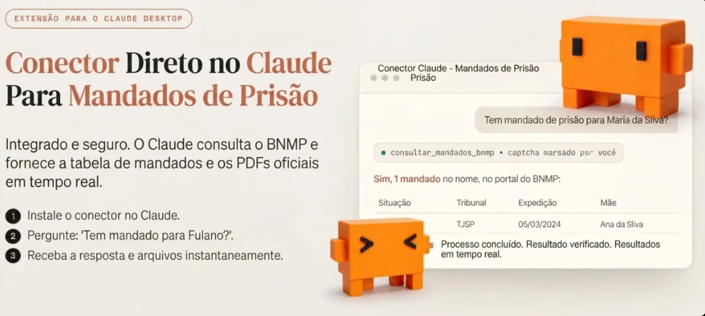

<p align="center">
  
</p>

<p align="center">
  <a href="https://github.com/pedrosoandre/bnmp-consulta/releases/latest"></a>
  
  <a href="#para-desenvolvedores-skill-do-claude-code-e-integração"></a>
  <a href="LICENSE"></a>
</p>

<h3 align="center">Consulte mandados de prisão do CNJ conversando com o Claude.<br>Você marca o captcha; o Claude traz a tabela e os PDFs oficiais.</h3>

---

O **BNMP** (Banco Nacional de Medidas Penais e Prisões, do CNJ) é a fonte oficial dos mandados de prisão expedidos por todos os tribunais do Brasil. É público, mas foi feito para consulta manual: uma tela, um captcha, uma pessoa de cada vez.

Este **conector do Claude Desktop** coloca o BNMP dentro da conversa. (No Claude Desktop, conectores locais como este são instalados como **extensões**, por isso o arquivo é um `.mcpb`.)

> **Você:** Tem mandado de prisão para Maria da Silva? Baixa os PDFs.
>
> **Claude:** abre o portal numa janela pequena → você marca "Não sou um robô" → o Claude pesquisa, lê os resultados, baixa os PDFs e responde com a tabela.

Sem terminal, sem Python, sem programar.

## Instalar em 1 minuto

1. Baixe o arquivo **`bnmp-consulta.mcpb`** da [última versão](https://github.com/pedrosoandre/bnmp-consulta/releases/latest).
2. No **Claude Desktop**, vá em **Configurações → Extensões → Configurações avançadas → Instalar extensão…** e escolha o arquivo.
3. Numa conversa, pergunte: *"Tem mandado de prisão para Maria da Silva?"*
4. Marque "Não sou um robô" na janela que abrir. Ela fecha sozinha no fim.

Precisa do Microsoft Edge ou do Google Chrome instalado (o Windows já vem com o Edge). Os registros (JSON) e os PDFs ficam em `Documentos\BNMP consultas`, ou na pasta que você escolher nas configurações da extensão.

> Funciona no **Claude Desktop para Windows e Mac**. Não funciona no claude.ai pelo navegador nem no app do celular, porque o captcha precisa abrir uma janela no seu computador.

## O que dá para pedir

| Pedido | O que acontece |
|---|---|
| *"Tem mandado para Fulano?"* | Tabela com número, situação, peça, tribunal, órgão, datas e filiação |
| *"Só me diz sim ou não para Fulano"* | Resposta curta: SIM/NÃO, quantos mandados e em quais tribunais |
| *"Consulta Fulano e baixa os PDFs"* | Também baixa o PDF oficial de cada mandado |
| *"Verifica estes 5 sócios: …"* | Consulta em lote: um captcha vale para até 10 nomes, na mesma janela |

## Ferramentas da extensão

| Ferramenta | Para quê |
|---|---|
| `consultar_mandados_bnmp` | Começa a consulta de um nome (opções: PDFs, nº de páginas, resposta curta) |
| `consultar_mandados_bnmp_em_lote` | Consulta vários nomes com um captcha só |
| `resultado_consulta_bnmp` | Traz o andamento ou o resultado |
| `cancelar_consulta_bnmp` | Cancela e fecha a janela |

## Para quem é

| Setor | Onde a consulta entra |
|---|---|
| **Advocacia, defensoria e assessoria jurídica** | Situação atualizada de clientes e partes, com o mandado em PDF para o processo |
| **Compliance, PLD e KYC** | Due diligence de sócios, administradores, fornecedores e clientes de alto risco |
| **Bancos, fintechs e crédito** | Etapa extra na análise de cadastros de risco elevado |
| **Fusões, aquisições e investimentos** | Checagem dos sócios e gestores da empresa-alvo |
| **Segurança privada, escolas, clínicas e cuidadores** | Quem vai trabalhar em áreas sensíveis ou com pessoas vulneráveis (veja [Uso responsável](#uso-responsável)) |
| **Jornalismo e checagem de fatos** | Confirmar, na fonte oficial, a situação de figuras públicas |

## Para desenvolvedores: skill do Claude Code e integração

O mesmo repositório traz uma **skill para o Claude Code** e um script em Python que roda sozinho, para levar a consulta para dentro de qualquer sistema.

### Instalar a skill no Claude Code

No Claude Code:

```
/plugin marketplace add pedrosoandre/bnmp-consulta
/plugin install bnmp-consulta@bnmp-consulta
```

E uma vez no computador:

```
pip install playwright
```

A skill usa o Edge ou o Chrome que você já tem. Se não tiver nenhum dos dois, rode também `python -m playwright install chromium`.

### Usar a skill

Peça do jeito que você falaria:

> **"Consulta se a Maria da Silva tem mandado de prisão e baixa os PDFs."**
>
> **"Verifica no BNMP os três sócios deste contrato social."**
>
> **"Coloca no meu sistema um botão de consulta de mandados na ficha do cliente."**
>
> **"Meu app em React precisa de uma tela de consulta de mandados."**

O Claude escolhe sozinho o caminho certo para cada caso: consultar agora, integrar no seu backend ou criar a tela no seu app.

### Integrar em qualquer sistema

O coração da skill é um único arquivo, [`consulta_bnmp.py`](skills/consulta-mandados-bnmp/scripts/consulta_bnmp.py), que depende só do Playwright. Copie para o seu projeto e chame:

```bash
python consulta_bnmp.py "Maria da Silva" --pdf --saida bnmp-saida
```

**Python**

```python
import json, subprocess, sys

def consultar_bnmp(nome: str) -> dict:
    p = subprocess.run([sys.executable, "consulta_bnmp.py", nome, "--pdf"],
                       capture_output=True, text=True, encoding="utf-8", timeout=600)
    if p.returncode != 0:
        raise RuntimeError(p.stderr.strip())
    return json.loads(p.stdout)
```

**Node.js**

```js
import { execFile } from "node:child_process";

export const consultarBnmp = (nome) => new Promise((ok, falha) =>
  execFile("python", ["consulta_bnmp.py", nome, "--pdf"], { encoding: "utf8", timeout: 600_000 },
    (erro, stdout, stderr) => (erro ? falha(new Error(stderr.trim())) : ok(JSON.parse(stdout)))));
```

**App web ou mobile para o público?** O servidor não consegue resolver o captcha por ninguém. Nesse caso, o app copia o nome e abre o portal para a pessoa. O exemplo pronto, com as armadilhas já resolvidas (`window.open` com `noopener` devolvendo `null`, área de transferência que falha em WebView, pop-up bloqueado), está em [`integracao-app.md`](skills/consulta-mandados-bnmp/integracao-app.md).

### O que você recebe

```json
{
  "busca": "Maria da Silva",
  "consultado_em": "2026-11-26T10:20:24",
  "fonte": "https://portalbnmp.cnj.jus.br/#/pesquisa-peca",
  "total_no_portal": 1,
  "mandados": [{
    "numero": "0001234-56.2024.8.26.0050.01.0001-01",
    "nome": "MARIA DA SILVA",
    "situacao": "Pendente de Cumprimento",
    "peca": "Mandado de Prisão",
    "orgao": "1ª Vara Criminal de São Paulo",
    "tribunal": "TJSP",
    "uf": "SP",
    "data_expedicao": "05/03/2024",
    "processo": "00012345620248260050",
    "nome_mae": "ANA DA SILVA",
    "data_nascimento": "02/01/1990",
    "pdf": "bnmp-saida/pdf/0001234-56.2024.8.26.0050.01.0001-01.pdf"
  }]
}
```

*(Dados fictícios; principais campos. O JSON também traz alcunha e identificadores internos do portal.)* Cada consulta também fica gravada em `bnmp-saida/consulta_<nome>_<data>.json`, o que serve de trilha de auditoria.

Códigos de saída para o seu sistema tratar:

| Código | Significa |
|---|---|
| `0` | Ok, inclusive quando não há mandados |
| `2` | Nome inválido |
| `3` | O portal bloqueou (403): pare e tente outro dia |
| `4` | Captcha não resolvido ou janela fechada |
| `5` | Outro erro do portal |
| `6` | Falta o Playwright ou um navegador |

## Feita para não dar dor de cabeça

- **Sem truque com o captcha.** Quem resolve é uma pessoa, sempre. Nada de serviço de quebra de captcha, navegador oculto ou sessão reaproveitada.
- **Sem coleta em massa.** A skill consulta uma pessoa por vez e recusa curingas (`*`) de propósito.
- **Respeita o portal.** Pausas entre chamadas, e no primeiro bloqueio (403) ela para em vez de insistir.
- **Não guarda o que você não pediu.** Grava só o JSON e os PDFs da consulta, na pasta que você escolher.
- **Testada.** Testes automáticos sem rede (Python e Node), mais consultas reais no portal.

Na prática, o seu time de compliance, jurídico ou segurança da informação consegue aprovar o uso sem ressalvas sobre a forma de acesso.

## Uso responsável

- **Homônimos:** a busca é por nome, e nomes se repetem. Antes de concluir que um mandado é da pessoa, confira nome da mãe, data de nascimento e número do processo.
- **Não é certidão:** "nenhum mandado" significa nada no BNMP para aquele nome naquela data. Não substitui certidão de antecedentes.
- **Contratações:** o TST firmou tese (IRR 243000-58.2013.5.13.0023) de que exigir antecedentes criminais de candidato só é legítimo quando há previsão em lei, quando a natureza do ofício exige ou quando o cargo pede grau especial de confiança. Exemplos: cuidadores, motoristas de carga, vigilantes e quem lida com armas, valores ou informações sigilosas. Fora disso, a checagem pode gerar indenização por dano moral. Use com critério.
- **Decisão final de uma pessoa:** o resultado é um insumo. A decisão sobre alguém deve passar por uma pessoa que analise o caso.

## Perguntas frequentes

**Dá para rodar sozinho, de madrugada, numa lista de mil nomes?**
Não, e isso é proposital. O portal exige um captcha por sessão. Automatizar isso significaria burlar uma proteção do CNJ, e este projeto não faz isso. O máximo é o lote: um captcha para até 10 nomes.

**Funciona num servidor na nuvem?**
Só se houver uma pessoa na frente da tela para marcar o captcha. Para apps abertos ao público, use a [passagem para o portal](skills/consulta-mandados-bnmp/integracao-app.md).

**Preciso de conta ou cadastro no CNJ?**
Não. O BNMP é público.

**Preciso do Claude Code?**
Não. Para conversar, basta o Claude Desktop com a extensão. O Claude Code e o script `consulta_bnmp.py` são para quem desenvolve.

**Quanto custa?**
Nada. É código aberto, sob a licença MIT.

**E se o CNJ mudar o portal?**
O script pode parar de funcionar até ser atualizado. [Abra uma issue](https://github.com/pedrosoandre/bnmp-consulta/issues); contribuições são bem-vindas.

## Estrutura

```
.claude-plugin/                     manifesto do plugin e do marketplace
skills/consulta-mandados-bnmp/
  SKILL.md                          instruções que o Claude segue
  integracao-app.md                 guia para apps web e mobile
  scripts/consulta_bnmp.py          a consulta (um arquivo, só depende do Playwright)
conector/                           extensão do Claude Desktop (servidor MCP em Node), empacotada como .mcpb
  server/                           servidor; usa o Edge/Chrome já instalados
  test/                             testes (npm test), sem rede
tests/                              testes automáticos, sem rede
```

## Testes

```
pip install pytest playwright
python -m pytest -q
cd conector && npm install && npm test
```

---

<sub>Projeto independente e de código aberto. **Não tem vínculo com o Conselho Nacional de Justiça (CNJ) nem com a Anthropic.** Claude é marca da Anthropic. Os dados vêm do portal público do BNMP e pertencem a quem os publica. Licença [MIT](LICENSE).</sub>
